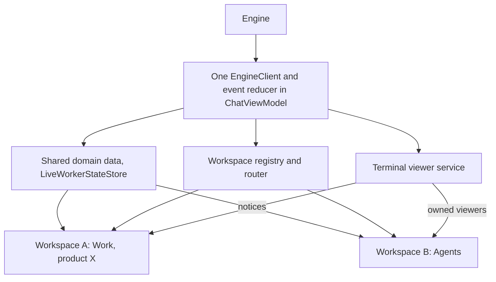

# Native window tabs with tear-off: one workspace per tab, one live terminal viewer per session

- **Date:** 2026-11-11
- **Status:** Design for review; no implementation has started.
- **Input:** the native window tabs investigation, `tools/boss/docs/investigations/native-window-tabs.md` ([mono#3532](https://github.com/spinyfin/mono/pull/3532), open at the time of writing).
- **Source baseline:** `59b0d69a4d2e` on `main`. Code claims below come from reading that revision; nothing in this document was observed at runtime.
- **Scope:** the Boss macOS app (`tools/boss/app-macos`). No engine, protocol or `bossctl` change.

Each native macOS tab becomes a full, independently navigable Boss workspace window, so Agents can be dragged out of the tab bar onto another display and merged back. The contested part is terminals: **a worker's or the coordinator's terminal is live in exactly one window at a time, and it follows the window that is actually showing it by re-attaching a fresh tmux viewer there, not by sharing or moving a Ghostty surface.** This departs from the investigation, which recommended first-claim ownership with no transfer in the first version.

## Verdict

Adopt the investigation's model (workspace per tab, per-window presentation state, one engine connection, AppKit-native tab grouping) with four changes:

1. **Terminal ownership moves.** Ownership follows presentation (see [Terminal viewer ownership](#terminal-viewer-ownership)). Without that, the headline workflow fails: the first workspace already hosts every worker terminal in its hidden Agents page, so a new Agents tab would show nothing but "open elsewhere" notices.
2. **Terminal surfaces are disposable.** Viewers are tmux clients; the durable thing is the tmux session. Moving ownership tears the old viewer down and attaches a new one. The investigation's requirement to retain the host view and its scrollback is dropped, with reasons below.
3. **The window host is chosen by a spike that runs first**, not by a gate inside the seventh PR. It chooses between two hosts with criteria fixed in this document.
4. **The state refactors are not behind the flag.** They fix a defect that exists today (see [Finding](#finding-multiple-windows-are-already-reachable-and-nobody-decided-how-they-behave)). The flag gates only the new entry points and restoration.

Eleven PR-sized tasks; the investigation's nine with two capability splits (the Work selection move, and a first-position host spike) and none dropped.

## Finding: multiple windows are already reachable, and nobody decided how they behave

The main scene is an unkeyed `WindowGroup` whose default File › New Window command is still present (`Sources/BossMacApp.swift`; the app only adds items after `.newItem`). No source sets `tabbingMode`, `tabbingIdentifier` or `allowsAutomaticWindowTabbing`, so AppKit's defaults also apply. Under those defaults Window › Merge All Windows and View › Show Tab Bar are available today; this is expected from the documented defaults and was not observed in a running app.

A second window today shares one `ChatViewModel` (same page, product, filters, selection), and its `ContentView.task` overwrites the pane attach, detach, focus, list and coordinator handlers with closures over its own `WorkersWorkspaceModel` and `BossPaneModel`. The last window to appear silently takes over terminal hosting.

No recorded decision covers this. The reading taken here is that multi-window behaviour was never designed, not that a design was lost. Consequence: per-window state and app-level terminal ownership are corrections to shipped behaviour, so they land unconditionally and are verified in the single-window app first.

## Goals

- Each native tab is a full Boss workspace: its own page (Agents, Work, Designs, Automations, Ideas), product, project filters, search, selection and toolbar context.
- A tab can be dragged out to its own window, placed on another display, and merged back by drag, Window › Merge All Windows, or Window › Move Tab to New Window, using AppKit's own tab machinery.
- Tear-off, merge, reorder, display moves and full screen never restart a worker, reset the coordinator, lose terminal history, or deliver input to the wrong terminal.
- One engine connection, one event reducer, one set of polls and notifications, regardless of window count.
- Workspaces, their grouping and their display placement return after a normal quit and relaunch.
- Ships behind a default-off flag; with the flag off no new workflow is reachable.

## Non-goals

- **Mirrored terminals.** The same terminal is never interactive in two windows at once.
- **Terminal scrollback surviving a relaunch of the app** beyond what tmux already keeps.
- **A workspace selector for external callers** (`bossctl reveal --workspace …`). Routing rules below need no protocol change.
- **Tabs for auxiliary windows.** Settings, Notifications, Activity, the markdown and design-doc viewers, transcripts, screenshots, the review terminal and diagnostics stay separate windows.
- **A custom tab strip, or replacing the Mode picker.** The picker stays as navigation inside a workspace.
- **Engine, protocol or `bossctl` changes.**
- **Raising the macOS 15 deployment floor.**

## Alternatives considered

### Product shape

| Alternative                                   | Why not                                                                                                                                                                                                                                                                                                                                    |
| --------------------------------------------- | ------------------------------------------------------------------------------------------------------------------------------------------------------------------------------------------------------------------------------------------------------------------------------------------------------------------------------------------ |
| Dedicated singleton Agents window             | Smaller (the investigation estimates days, not weeks), and it would put Agents on a second display. It is rejected on the stated goal, not on quality: it gives no interchangeable tabs, no merge-back, and no second board. It also still needs the handler-ownership fix above, so it is not a subset that could ship first and be kept. |
| Custom SwiftUI tab strip with drag and drop   | Boss would own detachment, drop targets, accessibility, Window-menu items and restoration that AppKit already provides for `NSWindow` tab groups. It removes none of the state or terminal work.                                                                                                                                           |
| One fixed window per page (page-keyed scenes) | Opening an existing value focuses its window, so two boards for two products are impossible, and the Mode picker would need per-window special cases.                                                                                                                                                                                      |

### Window host

Two hosts can deliver native tabs: the existing SwiftUI `WindowGroup` plus a small AppKit bridge, or `NSWindowController`-owned windows hosting the SwiftUI content. Neither is rejected here. The `WindowGroup` host is the default because it keeps the toolbar, titlebar accessory and split-view root integration that `Sources/ContentView.swift` documents as fragile. The first task is a **choosing** study between the two; see [Host spike](#host-spike-a-choosing-study).

### Terminal ownership

| Alternative                                                        | Why not                                                                                                                                                                                                                                                                                                                                                                                                                                                                                                                                                                                                                             |
| ------------------------------------------------------------------ | ----------------------------------------------------------------------------------------------------------------------------------------------------------------------------------------------------------------------------------------------------------------------------------------------------------------------------------------------------------------------------------------------------------------------------------------------------------------------------------------------------------------------------------------------------------------------------------------------------------------------------------- |
| First claim wins, no transfer (the investigation's recommendation) | Every `ContentView` keeps its Agents tree mounted at zero opacity and hosts every attached worker there. The first workspace therefore owns all worker terminals before the user opens a second tab. "Open Agents in New Tab, drag it to the other display" would show only notices. The requirement this fails is the project goal itself.                                                                                                                                                                                                                                                                                         |
| Mirrored viewers: every window attaches its own tmux client        | tmux supports several clients per session, so this is feasible. Rejected for three checkable reasons: a tmux window has one size, so two differently sized windows make the worker's TUI reflow as activity alternates (the engine sets no `window-size` option; `engine/core/src/coordinator_tmux.rs` and `spawn_flow.rs` set only history, exit, key and focus options); each window would create its own Ghostty surface per worker, multiplying renderers across up to 40 viewer slots; and the engine's attach contract is one hosted pane per run per app. No code path in the app attaches two clients to one session today. |
| Keep one Ghostty surface and move its host view between windows    | Feasible in principle (Ghostty's own app re-parents surfaces). Rejected because it buys nothing durable here: see [Why surfaces are disposable](#why-surfaces-are-disposable). It would add a mount wrapper whose removal must not free the surface, a second surface lifecycle beside the existing create/tear-down one, and Metal-layer moves between displays, none of which the app exercises today. It stays available as an internal optimisation of the transfer step if measured takeover time proves too slow (see Risks).                                                                                                 |

## Chosen approach

### Model

- **Workspace.** A `WorkspaceModel` (new, `@MainActor ObservableObject`) per window, identified by a `WorkspaceID` (UUID). It owns all presentation state for that window.
- **Workspace registry.** App-level. Tracks live workspaces, each one's weak `NSWindow`, and a most-recently-active order (updated when a workspace window becomes key). It exposes `activate(workspace)`: select its native tab, deminiaturize, bring to front.
- **Shared services.** `ChatViewModel` remains the single owner of the engine connection, domain caches and effects. It is not cloned: its initializer creates the transport, process controller, comment bridge and review notifier.
- **Terminal viewer service.** App-level. Owns the ledger of attached terminals and answers every engine pane request.

### Per-window and shared state

| State                                                                                                              | Owner                                                                        |
| ------------------------------------------------------------------------------------------------------------------ | ---------------------------------------------------------------------------- |
| Page (`navigationMode`), selected product, project filter set, chores-only                                         | Workspace                                                                    |
| Board search text, grouping, blocked / parked / archived / chore toggles, selected card and node, reveal highlight | Workspace                                                                    |
| Derived board sections and their cache                                                                             | Workspace (computed from shared domain data and that workspace's selection)  |
| Work sidebar visibility, coordinator panel width and collapse, search expansion, column scroll anchors             | Workspace / its view tree                                                    |
| Agents grid page, type and project filters, layout, focused run                                                    | Workspace (`AgentsGridModel`, already per view tree)                         |
| Selected idea and its open draft, selected design doc, selected automation and history visibility                  | Workspace. Saved content and `IdeaDraftCache` stay shared and keyed by idea. |
| Pending create / edit / park requests, sheets, popovers, confirmation dialogs, inline work error notice            | The workspace that started them                                              |
| Products, projects, tasks, dependencies, attentions, ideas, automations, live worker feed                          | Shared (`ChatViewModel`, already keyed by product or item)                   |
| Connection health, auth, settings, update state, board style, feature flags                                        | Shared; shown in every workspace, effects performed once                     |
| Attached terminals, their sessions and owners                                                                      | Terminal viewer service                                                      |
| Topic subscriptions, critical-priority poll, background-work poll                                                  | Shared; one instance each                                                    |

**Selection-dependent logic is parameterised, not forwarded.** Board sections, lookups and attention collections currently read `currentSelectedProductID` and friends from the shared model. They become functions of a `WorkspaceSelection` value, with caches keyed by workspace. Workspace views read only their own `WorkspaceModel`.

**The active-workspace facade.** `ChatViewModel` keeps `selectedWorkProductID`, `selectedProjectFilterIDs` and the other existing selection accessors as a thin facade over the most recently active workspace. This is a real, retained concept, not a migration shim: auxiliary windows (Notifications is product-scoped), `bossctl selected-product` and reveal routing all need "the workspace the user last used". It also keeps the 36 test files that set these properties valid, because what they pin (one workspace's behaviour) stays true. The rule that makes this safe: **no view inside a workspace's content tree reads the facade.** A source-scan test enforces it once the migration completes.

**Subscriptions.** `desiredWorkTopics` currently includes one product topic and unsubscribes the previous product on switch. It becomes the union of every live workspace's product plus auxiliary-view interests, held as tokens. Closing a workspace removes its token only. Reconnect replays the union.

**Polls and effects.** The five-second critical-priority poll moves out of `ContentView` into the shared model so it runs once. Visibility-driven Automations reads aggregate across workspaces so one window hiding the page does not stop another's reads.

### Native tab behaviour

| Operation                                 | Behaviour                                                                                                                                                                                                                          |
| ----------------------------------------- | ---------------------------------------------------------------------------------------------------------------------------------------------------------------------------------------------------------------------------------- |
| Tab identity                              | Workspace windows share one `tabbingIdentifier` (`boss.workspace`). The identifier is a compatibility class only; workspace identity is the UUID.                                                                                  |
| Tab title                                 | `<Page> — <Product>`, for example "Agents — Mono". Today the title is the product alone, so two pages of one product would be indistinguishable in the tab bar and Window menu.                                                    |
| New Window (⌘N)                           | New workspace seeded from the active one. `tabbingMode` stays `.automatic`, so the system "Prefer tabs" setting decides whether it joins the group.                                                                                |
| New Tab (⌘T, tab bar plus)                | New workspace seeded with the originating workspace's page, product and project filters, always added to the originating window's group with `addTabbedWindow(_:ordered:)`. Sheets, pending requests and selection are not copied. |
| Open Agents in New Tab                    | As New Tab, seeded with the Agents page. This is the direct route to the headline workflow.                                                                                                                                        |
| Drag out, drag back, reorder              | AppKit only. Boss never closes and reopens a scene to simulate a move.                                                                                                                                                             |
| Merge All Windows, Move Tab to New Window | Standard responder-chain actions with AppKit validation; no Boss shortcut is invented.                                                                                                                                             |
| Auxiliary windows                         | `tabbingMode = .disallowed`, so Merge All Windows cannot pull a viewer or Settings into a workspace group.                                                                                                                         |
| Full screen                               | A tab group enters full screen as one window on its display; a torn-off workspace can be full screen on another display independently.                                                                                             |

`openWindow` returns no `NSWindow` and takes no destination group. The bridge therefore records a pending "new tab for group of workspace X" request keyed by the new workspace's UUID and fulfils it when that workspace's window registers. It never picks `NSApp.windows.last` and never waits on a timer.

### Host spike: a choosing study

This study **chooses between two hosts**. It is not a check that the preferred one works, and its result is recorded before any task that depends on the host begins.

It builds a fixture, runnable only in an isolated instance, that opens two workspace windows, groups them, moves a tab to a new window, merges, closes and relaunches, and logs window, content-view and probe-view identities at each step.

| Question                                                                                                                           | `WindowGroup` + bridge is chosen if                                         | Otherwise                                                                                               |
| ---------------------------------------------------------------------------------------------------------------------------------- | --------------------------------------------------------------------------- | ------------------------------------------------------------------------------------------------------- |
| Can a new workspace window be seeded and added to a specific group before it is first shown, without a timer?                      | Yes, on every run of the fixture                                            | `NSWindowController` host                                                                               |
| Do the workspace UUID, `NSWindow` and content view survive move-to-new-window and merge?                                           | Yes                                                                         | `NSWindowController` host                                                                               |
| With restoration enabled, do the windows, their grouping, selected tabs and frames come back?                                      | Windows and frames come back; grouping may be supplemented by Boss's record | If windows or their UUIDs do not come back at all, `NSWindowController` host with `NSWindowRestoration` |
| Do the toolbar, titlebar accessory and split-view sidebar render correctly in a tabbed and a torn-off window? (capture comparison) | Yes                                                                         | Recorded as a defect to fix in the native-tabs task; not a host switch                                  |

The outcome is committed as an amendment to this document in the spike's own PR, so the host named in the later tasks and the evidence for it change in one diff. The state and terminal tasks do not depend on the outcome: they are identical under both hosts.

The terminal design is deliberately insensitive to the second question. If a host turned out to rebuild content on tear-off, a viewer would be re-attached once, which the ownership contract already permits.

### Terminal viewer ownership

#### Why surfaces are disposable

- Worker and coordinator panes are **viewers**: each Ghostty surface runs `tmux attach-session` against an engine-owned detached session (`Sources/Ghostty/WorkersWorkspaceModel.swift`, `Sources/Ghostty/BossPaneModel.swift`). The agent process, its screen and its history live in tmux.
- The engine sets no alternate-screen override, so the tmux client draws in the alternate screen and the Ghostty surface accumulates no scrollback of its own. This is a code-reading claim; the acceptance task confirms it by comparing history before and after a transfer.
- The app already recreates viewers as routine practice: `BossPaneModel.reattachViewer` rebuilds the coordinator's client whenever it exits, and surface creation is retried after display changes. Re-attaching on transfer is the same operation, not a new risk class.

The load-bearing property is therefore **one live viewer and one input target per durable tmux session**, not the identity of an `NSView` or `ghostty_surface_t`. Invariants are stated at that level.

#### Ledger

One entry per attached terminal, keyed by `worker(runId)` or `coordinator`:

- the **attach descriptor** from the engine (tmux socket, session name, slot, titles; for the coordinator, the spawn token),
- the **owner** workspace ID, or none,
- the current **viewer session** (`TerminalPaneSession`), or none,
- a **generation**, incremented on every owner change or viewer rebuild.

The service installs the engine handlers once (attach, detach, focus, list hosted panes, pool config, coordinator attach, send-to-coordinator). No view installs them.

#### Presenting

A workspace **presents** a terminal kind when all three hold:

1. its page is the one that shows that kind (Agents for workers, Work for the coordinator),
2. its window is the selected tab of its tab group, or is not in a group,
3. its window is not miniaturized.

Occlusion by other windows, other Spaces and app hiding are deliberately not inputs: they are not reliably observable and would make ownership jitter.

#### Ownership rules

| Event                                                                              | Result                                                                                                                                                                                                  |
| ---------------------------------------------------------------------------------- | ------------------------------------------------------------------------------------------------------------------------------------------------------------------------------------------------------- |
| Engine attaches a terminal                                                         | Owner is the most recently active workspace that presents its kind. If none presents it, the most recently active workspace hosts it hidden, exactly as the single window does today.                   |
| A workspace starts presenting (page switch, tab selected, deminiaturized, created) | It takes every terminal of that kind whose owner is **not** presenting. Terminals whose owner is presenting stay where they are; this workspace shows a notice for them.                                |
| The owner stops presenting                                                         | If another workspace is presenting, the terminal moves to the most recently active one. Otherwise nothing changes and the viewer stays alive hidden.                                                    |
| Tear-off, drag back, reorder, move to another display, full screen                 | No ownership change by themselves. A merge or tear-off that changes which tab is selected is handled by the two rows above.                                                                             |
| A window becomes key (focus)                                                       | **No ownership change.** Clicking into a window never takes a terminal away from another window that is showing it.                                                                                     |
| User presses Move Terminal Here in a notice                                        | The terminal moves to that workspace, even though the previous owner is still presenting. The previous owner now shows the notice.                                                                      |
| The owner's window closes                                                          | Re-run the attach rule over the remaining workspaces. With no workspace left, the entry keeps its descriptor with no owner and no viewer; the next workspace created claims it. The engine is not told. |
| Engine detaches a terminal                                                         | Entry removed; its viewer is torn down.                                                                                                                                                                 |

Concrete cases:

- **Headline workflow.** One window on Work hosts all workers hidden. The user opens Agents in a new tab: that tab presents, the Work tab does not, so every worker terminal moves to the new tab. Dragging the tab to another display changes nothing further.
- **Two Agents windows side by side.** Each terminal stays with whichever window had it. The other window shows a notice with Move Terminal Here. Nothing moves on focus.
- **Two Agents tabs in one group.** Only the selected tab presents, so terminals follow tab selection.
- **Two Work windows.** The coordinator terminal is live in one; the other shows the notice in the coordinator panel.

#### Invariants

1. At most one host view per terminal is in a window's view hierarchy, so at most one can be first responder and receive input.
2. While at least one workspace exists, every attached terminal has exactly one owner.
3. If any workspace presents a kind, each terminal of that kind is owned by a presenting workspace.
4. Each engine pane request is answered exactly once, by the service, whatever the window count. Ownership changes send nothing to the engine: it sees one continuously hosted pane.
5. A callback or queued input carrying an older generation than the entry's is dropped.

#### Transfer

On the main actor, in one synchronous step: mark the old viewer session released, increment the generation, set the new owner, create a new viewer session from the stored descriptor. SwiftUI then removes the old workspace's `GhosttyTerminalView` (the existing `tearDown` path, which drains focus work and frees the surface off the main thread) and mounts one in the new owner.

For a short interval the old tmux client may still be exiting while the new one attaches. Invariant 1 holds throughout because the old host has left the hierarchy; the tmux client count returns to one once the old surface is freed. The acceptance task measures that interval and the time to an interactive terminal.

The coordinator's exit-triggered reattach is already guarded by a viewer generation; the released viewer's exit must not schedule a rebuild. Transfers caused by one user action are coalesced so a tab switch produces one pass.

#### What a non-owning window shows

In the terminal's normal cell (or the coordinator panel):

- the same header as the owner shows: worker name, task title, live status from `LiveWorkerStateStore`;
- the text "Terminal is open in ‹owner tab title›";
- **Show Window**: activates the owner workspace and focuses the terminal;
- **Move Terminal Here**: transfers ownership to this workspace.

The notice is not focusable as a terminal, takes no key input, and creates no surface and no tmux client. Both buttons carry accessibility labels naming the worker and the owning tab.

#### Input, resize and focus routing

- **Keyboard and mouse.** Delivered by AppKit to the first-responder host in the key window. Only the owner has a host, so there is nothing to arbitrate.
- **Programmatic input.** "Send to Coordinator" goes to the service, which submits to the owner's host. If a transfer is in flight it waits for the new viewer to become ready, bounded, and otherwise reports failure as it does today when no host exists.
- **Resize.** A terminal's size comes only from its owner's cell geometry, so the tmux window has one size source. Notice cells are laid out by their own window and influence nothing. Live-resize notifications are filtered to the grid's own window; today every grid reacts to any window's resize and asks whether any window is resizing.
- **Cell metrics.** `GhosttyRuntime.onCellSizeChanged` and `onWorkerFocus` are single-slot callbacks that each Agents view overwrites. They become keyed, multi-subscriber notifications routed through the service.
- **Focus.** A host becoming first responder reports (terminal key, generation); the service forwards it to the owner workspace's grid only. Hidden tabs cannot hold terminal focus because they do not present.
- **Display moves.** The host updates its display ID only when size or scale also changes (`applyGeometryNow` in `Sources/Ghostty/GhosttyTerminalView.swift`). Moving a window between two equal-scale displays at unchanged size can leave it stale. The display ID is synchronised on its own, on the owning window's screen change. This is a code-path finding, not an observed rendering fault.

### Command routing

Workspace actions are published with `focusedSceneValue` and read in command views with `@FocusedValue`, so the menu bar targets the key workspace even when focus is inside a terminal. The app uses neither API today.

| Entry point                                                                          | Target                                                                                                                                                                                                                                                           |
| ------------------------------------------------------------------------------------ | ---------------------------------------------------------------------------------------------------------------------------------------------------------------------------------------------------------------------------------------------------------------- |
| Mode picker, search, new task / project, filters, board style                        | The key workspace. Its ID is captured before any asynchronous work starts, so a result lands in the workspace that asked even if another becomes key.                                                                                                            |
| ⌘N, ⌘T, Open Agents in New Tab                                                       | Seeded from the key workspace; from an auxiliary window, from the most recently active workspace.                                                                                                                                                                |
| ⌘W, next / previous tab, Merge All Windows, Move Tab to New Window                   | AppKit responder chain on the key window.                                                                                                                                                                                                                        |
| `bossctl reveal`, notification click                                                 | The most recently active workspace already on the target product; otherwise the most recently active workspace; otherwise a new one. That workspace alone is activated, switched to Work, has its filters reconciled, and acknowledges once the card is visible. |
| `bossctl agents focus`, a card's agent button                                        | The terminal's owner: activate it, show Agents, focus the host. Ownership does not change.                                                                                                                                                                       |
| `bossctl open`, ⌘O, Finder open                                                      | Unchanged: the Design Doc viewer window, outside the tab group.                                                                                                                                                                                                  |
| `bossctl selected-product`                                                           | The most recently active workspace's product. Re-reported when the active workspace changes and after app-session registration.                                                                                                                                  |
| App-wide confirmations (coordinator model restart, coordinator reset, update / quit) | Presented once, by the most recently active workspace, not in every window.                                                                                                                                                                                      |

Reveal keeps its existing completion contract (acknowledge only when the viewport confirms visibility, fail on timeout or supersession) but per workspace. Closing the target workspace mid-reveal fails that reveal.

### Restoration

- With the flag on, restoration is enabled for the workspace scene only. Isolated and capture instances keep it disabled, and never write layout into production defaults (`Sources/BossDefaults.swift` already splits the suite).
- **Restored per workspace:** page, product, project filters, chores-only, search text, grouping and filter toggles, sidebar and panel layout.
- **Not restored:** card selection, sheets and popovers, pending requests, terminal ownership. Ownership is recomputed by the attach rule when the engine re-sends attaches after registration. No Ghostty pointer or tmux identity is ever persisted.
- The existing global selection defaults seed the first workspace of the first flagged launch only.
- The spike records what the system restores unaided. Boss supplements only the gap, with a versioned layout record (workspace IDs, a group ID, member order, selected member, frame, display UUID and that display's visible frame). One owner recreates windows; Boss's record regroups registered windows and never opens windows the system also restores.
- **Display fallback.** Prefer the saved display. If it is absent, clamp the frame into a current screen's visible frame with the titlebar reachable and a minimum content size. Saved coordinates are hints.
- The user's system "close windows when quitting" preference is honoured.

### Flag and rollout

- **Flag:** `boss.ui.nativeWorkspaceTabs` in `BossDefaults`, default off, toggled in the Feature Flags viewer beside `boss.ui.standardSearch`. Read once at launch; changing it requires a relaunch. The scene and window setup is never hot-switched.
- **Flag off:** no New Tab commands, no Open Agents in New Tab, no workspace tab identifier or titles change, restoration stays disabled, and no saved multi-workspace layout is applied. Window tabbing is left exactly as AppKit provides it today. A second window opened with ⌘N is still possible, as it is today; after the state and terminal tasks it behaves correctly instead of colliding.
- **Flag on:** the full feature.
- **Ships inert.** Every task before the native-tabs task changes structure, not workflow. The native-tabs task ships the feature dark. Anyone with the app can enable it in the Feature Flags viewer and relaunch.
- **Default-on** is a one-line change made after the acceptance matrix passes, including its manual rows. It is not listed as a task because its trigger is a person observing physical displays, which no worker run can do.

### Acceptance matrix

"Model" rows are unit tests under `bazel test //tools/boss/app-macos/...`. "Fixture" rows run in an isolated instance against a fixture engine (`env -u BOSS_EVENTS_SOCKET bazel run //tools/boss/engine/core:engine -- --socket-path <private path>`; app with `BOSS_SOCKET_PATH=<same> BOSS_ENGINE_AUTOSTART=0`) and are evidenced with `--capture-to`. "Manual" rows need a person at physical displays. A `cacheDisplay` capture proves layout only: it does not prove drag handling or live Metal rendering.

| Scenario                             | Must hold                                                                                                                                                                                                                | How             |
| ------------------------------------ | ------------------------------------------------------------------------------------------------------------------------------------------------------------------------------------------------------------------------ | --------------- |
| Single display, single window        | Behaviour identical to today with the flag off and on: one viewer per worker, coordinator intact, one subscription set, one poll.                                                                                        | Model, Fixture  |
| Two workspaces, one group            | Independent page, product, filters, search and drafts. Closing one keeps the other's product subscription. Tab titles distinguish them.                                                                                  | Model, Fixture  |
| Tear-off                             | Workspace ID, selection and scroll position unchanged. No worker spawn, no engine pane message, tmux client count per session is 1 afterwards. Typing reaches the visible terminal.                                      | Fixture, Manual |
| Merge (drag back, Merge All Windows) | Same checks as tear-off. Terminals owned by a tab that becomes unselected move to the selected presenting tab. Auxiliary windows are not merged.                                                                         | Fixture, Manual |
| Repeated tear-off and merge (10×)    | Ledger generation changes only when an owner changes. No leaked surfaces or tmux clients. tmux history identical before and after.                                                                                       | Fixture         |
| Two displays                         | A torn-off Agents window on the second display renders at the right scale, including an equal-scale move at unchanged size. Mixed-DPI move reflows correctly.                                                            | Manual          |
| Two Agents windows                   | Each terminal live in one window; the other shows the notice. Focus changes move nothing. Show Window and Move Terminal Here work and leave one client.                                                                  | Model, Fixture  |
| Main session's terminal pane         | Two Work windows show one live coordinator and one notice. Send to Coordinator arrives exactly once from any workspace. Transfer, close and reopen never reset the coordinator or trigger a reattach loop.               | Model, Fixture  |
| Relaunch restore                     | Two groups with selected tabs, per-workspace state and frames return on the same displays. With a display removed, windows are reachable on a remaining one. Capture instances restore nothing.                          | Fixture, Manual |
| Full screen per display              | A group full screen on one display and a torn-off workspace full screen on another. Entering and leaving full screen changes no ownership. Banners and sidebar toggles still work.                                       | Manual          |
| Sheets and popovers                  | A sheet belongs to the window that opened it and its result applies to that workspace's product even if another tab becomes key. App-wide confirmations appear once. Popovers do not survive a move with a stale anchor. | Model, Manual   |
| External commands                    | `bossctl reveal`, `agents focus`, `selected-product` follow the routing table with two workspaces; each request gets exactly one reply.                                                                                  | Model, Fixture  |
| Keyboard and accessibility           | Standard tab shortcuts work with focus in a terminal. Hidden pages are accessibility-hidden. Notices and their buttons are labelled.                                                                                     | Manual          |
| Sleep/wake, display unplug/replug    | Viewers recover without duplicates; windows stay reachable.                                                                                                                                                              | Manual          |

## Risks / open questions

| Risk                                                                                         | Mitigation or decision needed                                                                                                                                                                                                                         |
| -------------------------------------------------------------------------------------------- | ----------------------------------------------------------------------------------------------------------------------------------------------------------------------------------------------------------------------------------------------------- |
| Terminals following presentation surprises a user who expected them to stay put              | This is the central bet. The alternative policy (stay until moved explicitly) uses the same ledger and transfer step with one rule removed. Asked as an explicit question to the repo owner.                                                          |
| Takeover of many terminals at once is slow (up to 40 viewer slots re-attach on a tab switch) | The acceptance task measures time from tab selection to interactive terminals for a full grid. Threshold: over one second for 16 workers triggers replacing the transfer step with host re-parenting, which changes nothing outside the service.      |
| The host spike cannot run without putting windows on screen                                  | The fixture must run in an isolated instance. If AppKit will not group windows that were never ordered in, the worker records that and stops; the repo owner runs the documented fixture command by hand. Workers never show windows on this machine. |
| The facade leaks into workspace views and re-couples windows                                 | Source-scan test in the last state task; reviewers of the earlier state tasks check it by hand.                                                                                                                                                       |
| Toolbar, sidebar toggle or titlebar accessory regress inside a tab group                     | Covered by the spike's capture comparison and by the manual full-screen row. `TitlebarAccessoryHost` already re-installs when its host window changes.                                                                                                |
| Capture picks the wrong window                                                               | `BossCapture.pickWindowIndex` prefers the "agent capture" title, then the largest window. Several workspaces defeat that. The acceptance task adds explicit workspace selection; the single-window default is unchanged.                              |
| Manual rows have no owner                                                                    | Physical drag, mixed-DPI, unplug and full screen across displays cannot be done by a worker. The runbook from the acceptance task is run by the repo owner before default-on.                                                                         |
| Supported OS coverage                                                                        | The deployment floor is macOS 15, but only the worker host's OS is available to automated runs. Asked as an explicit question.                                                                                                                        |
| tmux history claim is wrong (surface does hold unique scrollback)                            | Checked in the repeated tear-off row. If it fails, the re-parenting optimisation becomes required rather than optional, still inside the service.                                                                                                     |

Questions for the repo owner are in the sibling `native-window-tabs-with-tear-off.attentions.json`: the ownership policy, and which macOS versions must pass before default-on.

## Proposed implementation task breakdown

Breakdown size: 11 entries (11 in-scope, 0 deferred) — the change is confined to the macOS app but crosses five real seams: the host decision (1 spike), workspace identity and subscriptions (1), presentation state split by the three independently reviewable groups of consumers plus command routing (4), terminal hosting split into the single-window service lift and the multi-window ownership rules (2), and the native-tab feature, its restoration and its acceptance evidence (3).

Dependency graph: entries 1 and 2 start immediately and in parallel. Entries 3 and 7 both follow 2 and may run in parallel. 4 follows 3, 5 follows 4, 6 follows 5. Entry 8 follows 3 and 7 and may run in parallel with 4–6. Entries 9, 10 and 11 are sequential after everything else.

File overlap: entries 3–6 all edit `Sources/ContentView.swift` and `Sources/ChatViewModel.swift` substantially, which is why they are ordered rather than parallel. Entry 7 also edits `Sources/ContentView.swift`, but only the pane-handler `.task` block and the two terminal `@StateObject`s; whichever of 3 and 7 lands second forward-ports the other's change, keeping both. Entry 8 stays in `Sources/Ghostty/` apart from one call site and does not conflict with 4–6.

All paths are relative to `tools/boss/app-macos/` unless they start with `tools/`. Sources and tests are globbed by `BUILD.bazel`, so new Swift files need no build edit.

### Native tab host spike and fixture

Scope: build the isolated-only fixture that opens, groups, tears off, merges and relaunches two workspace-shaped windows and logs identities, run it, and choose the window host using the criteria in "Host spike: a choosing study". The fixture uses probe views, not live terminals. The result amends this design document in the same PR.

Major deliverables:

1. A fixture mode, reachable only in an isolated instance, that performs the group, move-to-new-window, merge, close and relaunch sequence and logs window, content-view and probe-view identities.
2. A findings writeup with the observed answer to each of the four spike questions, the OS it ran on, and captures of a tabbed and a torn-off window.
3. An amendment to this design naming the chosen host, with any consequent change to the later entries visible in the same diff.

Likely changed files:

- `Sources/BossNativeTabProbe.swift` (new)
- `Sources/BossMacApp.swift`
- `Sources/BossCapture.swift`
- `Tests/BossTests/BossNativeTabProbeTests.swift` (new)
- `tools/boss/docs/investigations/native-window-tabs-host-spike.md` (new)
- `tools/boss/docs/designs/native-window-tabs-with-tear-off.md`

Estimated size: ~6 files / ~650 changed lines

Effort hint: `medium`

Dependencies: none

Scope: in-scope

### Workspace identity, registry and shared product interests

Scope: introduce the workspace as a first-class object without changing what the user sees. Each window gets a `WorkspaceModel` shell and registers its `NSWindow`; the registry tracks most-recently-active order and can activate a workspace. Product-topic subscriptions become a union over tokens, and the critical-priority poll runs once in the shared model. Ordered first because every later entry addresses state, routing or ownership by workspace ID.

Major deliverables:

1. `WorkspaceID`, a `WorkspaceModel` shell created at the window content root, and a `WorkspaceRegistry` with window registration, most-recently-active order and `activate`.
2. Tokenised union of product-topic interests replacing the single-product `desiredWorkTopics`, with reconnect replay and tests for add, remove and close.
3. The critical-priority poll moved from `ContentView` into the shared model so it runs once per connection.

Likely changed files:

- `Sources/Workspace/WorkspaceID.swift` (new)
- `Sources/Workspace/WorkspaceModel.swift` (new)
- `Sources/Workspace/WorkspaceRegistry.swift` (new)
- `Sources/Workspace/WorkspaceWindowObserver.swift` (new)
- `Sources/BossMacApp.swift`
- `Sources/ContentView.swift`
- `Sources/ChatViewModel.swift`
- `Sources/ChatViewModel+WorkLookups.swift`
- `Sources/ChatViewModel+Connection.swift`
- `Sources/ChatViewModel+ResyncRefetch.swift`
- `Tests/BossTests/WorkspaceRegistryTests.swift` (new)
- `Tests/BossTests/WorkSubscriptionUnionTests.swift` (new)
- `Tests/BossTests/WorkFetchOwnershipTests.swift`

Estimated size: ~13 files / ~950 changed lines

Effort hint: `medium`

Dependencies: none

Scope: in-scope

### Per-workspace page, product and project selection

Scope: move the page, selected product, project filter set and chores-only flag from `ChatViewModel` into `WorkspaceModel`, and introduce the active-workspace facade that keeps the existing accessors meaningful for auxiliary windows and existing tests. The navigator, Mode picker, work switcher, selection history, window title and selected-product reporting read the workspace. Ordered before the board entry because the board's derived state is a function of this selection.

Major deliverables:

1. `WorkspaceSelection` (page, product, project filters, chores-only) owned by `WorkspaceModel`, with the navigator, Mode picker, work switcher and title bound to it.
2. The active-workspace facade on `ChatViewModel`, with selected-product reporting and selection history driven by the most recently active workspace.
3. Tests with two workspaces on different products and pages: independent selection, correct subscription union, and the report following the active workspace.

Likely changed files:

- `Sources/Workspace/WorkspaceSelection.swift` (new)
- `Sources/Workspace/WorkspaceModel.swift`
- `Sources/ChatViewModel+ActiveWorkspace.swift` (new)
- `Sources/ChatViewModel.swift`
- `Sources/ChatViewModel+WorkSelection.swift`
- `Sources/ChatViewModel+WorkLookups.swift`
- `Sources/ChatViewModel+EventHandling.swift`
- `Sources/ChatViewModel+WorkItemEvents.swift`
- `Sources/WorkSelectionHistory.swift`
- `Sources/WorkSwitcherToolbar.swift`
- `Sources/ContentView.swift`
- `Sources/ContentViewChrome.swift`
- `Sources/BossRevisionReviewCapture.swift`
- `Tests/BossTests/WorkspaceSelectionTests.swift` (new)
- `Tests/BossTests/SelectedProductReportTests.swift`
- `Tests/BossTests/WorkSwitcherTests.swift`

Estimated size: ~16 files / ~1,200 changed lines

Effort hint: `large`

Dependencies: Workspace identity, registry and shared product interests

Scope: in-scope

### Per-workspace board filters, search and derived board state

Scope: move board search, grouping, the blocked / parked / archived / chore toggles, card and node selection, sidebar visibility and coordinator-panel layout into `WorkspaceModel`, and make board sections, badges and attention collections functions of a workspace's selection with a cache per workspace. Shared domain changes invalidate every workspace showing that product. Separate from the previous entry because the cache and invalidation rework is reviewable on its own once selection has moved.

Major deliverables:

1. Board presentation state and card selection owned by `WorkspaceModel`, with the board toolbar, board views and panels bound to it.
2. Board derivation parameterised by `WorkspaceSelection` with a per-workspace cache and product-keyed invalidation; the facade serves the active workspace's result.
3. Tests with two workspaces on one product holding different filters and search text, and on two products receiving interleaved engine events.

Likely changed files:

- `Sources/Workspace/WorkspaceModel.swift`
- `Sources/Workspace/WorkspaceBoardState.swift` (new)
- `Sources/ChatViewModel.swift`
- `Sources/ChatViewModel+ActiveWorkspace.swift`
- `Sources/ChatViewModel+WorkBoardSections.swift`
- `Sources/ChatViewModel+BoardHelpers.swift`
- `Sources/ChatViewModel+WorkBoardBadges.swift`
- `Sources/ChatViewModel+DoingSections.swift`
- `Sources/ChatViewModel+Attentions.swift`
- `Sources/ChatViewModel+WorkLookups.swift`
- `Sources/ChatViewModel+WorkSelection.swift`
- `Sources/ChatViewModel+WorkItemEvents.swift`
- `Sources/WorkBoardToolbar.swift`
- `Sources/WorkBoardCard.swift`
- `Sources/ContentView.swift`
- `Sources/ContentViewChrome.swift`
- `Tests/BossTests/WorkspaceBoardStateTests.swift` (new)
- `Tests/BossTests/ActiveProductsFilterTests.swift`

Estimated size: ~18 files / ~1,350 changed lines

Effort hint: `large`

Dependencies: Per-workspace page, product and project selection

Scope: in-scope

### Per-workspace Ideas, Designs and Automations presentation

Scope: move the selected idea and its open draft, the selected design document, and the selected automation with its history visibility into `WorkspaceModel`. Saved content, `IdeaDraftCache` and fetch state stay shared. Automations visibility-driven reads aggregate over workspaces. Closes the state migration, so it also adds the guard that workspace views do not read the facade.

Major deliverables:

1. Ideas selection and draft, design-doc selection and automation selection owned by `WorkspaceModel`, with the three page views bound to it; two workspaces can edit different ideas, and the same idea reconciles through the existing save path.
2. Reference-counted Automations visibility so one workspace leaving the page does not stop another's reads.
3. A source-scan test that fails when a file in the workspace content tree references an active-workspace facade accessor.

Likely changed files:

- `Sources/Workspace/WorkspaceModel.swift`
- `Sources/Workspace/WorkspaceSecondaryPagesState.swift` (new)
- `Sources/ChatViewModel.swift`
- `Sources/ChatViewModel+Ideas.swift`
- `Sources/ChatViewModel+AutomationHistory.swift`
- `Sources/ChatViewModel+DesignDocs.swift`
- `Sources/ChatViewModel+ActiveWorkspace.swift`
- `Sources/IdeasView.swift`
- `Sources/DesignsView.swift`
- `Sources/AutomationsView.swift`
- `Sources/ContentView.swift`
- `Tests/BossTests/WorkspaceSecondaryPagesTests.swift` (new)
- `Tests/BossTests/ChatViewModelIdeasTests.swift`
- `workspace_facade_scan_test.sh` (new)
- `BUILD.bazel`

Estimated size: ~15 files / ~1,100 changed lines

Effort hint: `medium`

Dependencies: Per-workspace board filters, search and derived board state

Scope: in-scope

### Window-scoped commands, reveal routing and transient UI

Scope: make every entry point pick one workspace. Menu commands read the key workspace through focused scene values. Reveal, notification clicks and selected-product reporting follow the routing table. Create / edit / park requests, the inline work error notice and app-wide confirmations carry an originating workspace ID so results and dialogs appear once, in the right window. Ordered after the state entries because routing needs each page's state to be per-workspace.

Major deliverables:

1. Focused-scene command context so menu and shortcut actions target the key workspace, including with focus inside a terminal.
2. Per-workspace reveal with the existing visibility-confirmed completion contract, target selection per the routing table, and failure on workspace close; exactly-once reply tests.
3. Originating-workspace IDs on pending create / edit / park requests, work error notices and app-wide confirmations, with tests that a result lands in the originating workspace after another becomes key.

Likely changed files:

- `Sources/Workspace/WorkspaceCommands.swift` (new)
- `Sources/Workspace/WorkspaceRouter.swift` (new)
- `Sources/Workspace/WorkspaceModel.swift`
- `Sources/BossMacApp.swift`
- `Sources/ContentView.swift`
- `Sources/ChatViewModel.swift`
- `Sources/ChatViewModel+Reveal.swift`
- `Sources/ChatViewModel+WorkSelection.swift`
- `Sources/ChatViewModel+EventHandling.swift`
- `Sources/ChatViewModel+WorkMutations.swift`
- `Sources/RevealCardViewport.swift`
- `Sources/WorkNoticeBanner.swift`
- `Sources/WorkFormSheets.swift`
- `Sources/WorkParking.swift`
- `Sources/CoordinatorResetStatus.swift`
- `Tests/BossTests/WorkspaceRouterTests.swift` (new)
- `Tests/BossTests/RevealClearsFiltersTests.swift`
- `Tests/BossTests/RevealViewportTests.swift`

Estimated size: ~18 files / ~1,300 changed lines

Effort hint: `large`

Dependencies: Per-workspace Ideas, Designs and Automations presentation

Scope: in-scope

### App-level terminal viewer service

Scope: lift terminal hosting out of the view tree with no visible change in a single window. A service owns the ledger (descriptor, owner, viewer session, generation) for workers and the coordinator and installs the engine pane handlers once, replacing the per-`ContentView` `WorkersWorkspaceModel` and `BossPaneModel` instances and the handler-binding task. Runtime focus and cell-size callbacks become keyed and multi-subscriber. With one workspace it is always the owner. Depends only on workspace identity, so it can proceed alongside the selection work.

Major deliverables:

1. The terminal viewer service and ledger, owning worker and coordinator descriptors and sessions and answering attach, detach, focus, list-hosted, pool-config, coordinator-attach and send-to-coordinator exactly once.
2. Keyed, multi-subscriber focus and cell-size notifications replacing the single-slot `GhosttyRuntime` callbacks, and live-resize handling filtered to the grid's own window.
3. Display-ID synchronisation on the owning window's screen change, independent of size or scale changes.

Likely changed files:

- `Sources/Ghostty/TerminalViewerService.swift` (new)
- `Sources/Ghostty/TerminalViewerLedger.swift` (new)
- `Sources/Ghostty/WorkersWorkspaceModel.swift`
- `Sources/Ghostty/BossPaneModel.swift`
- `Sources/Ghostty/BossPaneTerminalView.swift`
- `Sources/Ghostty/WorkersDetailView.swift`
- `Sources/Ghostty/AgentsGridModel.swift`
- `Sources/Ghostty/GhosttyRuntime.swift`
- `Sources/Ghostty/GhosttyTerminalView.swift`
- `Sources/Ghostty/TerminalPaneSession.swift`
- `Sources/ContentView.swift`
- `Sources/BossMacApp.swift`
- `Sources/ChatViewModel.swift`
- `Sources/ChatViewModel+Ideas.swift`
- `Tests/BossTests/TerminalViewerLedgerTests.swift` (new)
- `Tests/BossTests/WorkersWorkspaceModelTests.swift`
- `Tests/BossTests/IdeaCoordinatorSubmissionTests.swift`

Estimated size: ~17 files / ~1,350 changed lines

Effort hint: `large`

Dependencies: Workspace identity, registry and shared product interests

Scope: in-scope

### Terminal ownership across workspaces

Scope: implement the presenting definition, the ownership rules table, the five invariants and the transfer step, for workers and the coordinator. Non-owning workspaces render the notice with Show Window and Move Terminal Here. `bossctl agents focus`, card agent buttons and Send to Coordinator route to the owner. Needs per-workspace page state to compute presenting, and the service to hold owners.

Major deliverables:

1. Presentation-driven claim, yield and transfer in the service, including coalescing, generation checks on callbacks and queued input, close-time reassignment and the coordinator's guarded reattach.
2. The non-owner notice for worker cells and the coordinator panel, with Show Window and Move Terminal Here and their accessibility labels.
3. Owner-targeted routing for agent focus and Send to Coordinator, with model tests for every row of the ownership rules table and each concrete case listed under it.

Likely changed files:

- `Sources/Ghostty/TerminalViewerService.swift`
- `Sources/Ghostty/TerminalViewerLedger.swift`
- `Sources/Ghostty/TerminalOwnershipPolicy.swift` (new)
- `Sources/Ghostty/TerminalOwnerNoticeView.swift` (new)
- `Sources/Ghostty/WorkersDetailView.swift`
- `Sources/Ghostty/AgentSurfaceCollection.swift`
- `Sources/Ghostty/WorkerSlotBody.swift`
- `Sources/Ghostty/AgentFocusCoordinator.swift`
- `Sources/Ghostty/BossPaneModel.swift`
- `Sources/Ghostty/BossPaneTerminalView.swift`
- `Sources/Ghostty/AgentsGridModel.swift`
- `Sources/Workspace/WorkspaceModel.swift`
- `Sources/Workspace/WorkspaceWindowObserver.swift`
- `Sources/ContentView.swift`
- `Tests/BossTests/TerminalOwnershipPolicyTests.swift` (new)
- `Tests/BossTests/TerminalViewerTransferTests.swift` (new)
- `Tests/BossTests/AgentsFocusRevealTests.swift`
- `Tests/BossTests/AgentSurfaceCollectionTests.swift`

Estimated size: ~18 files / ~1,400 changed lines

Effort hint: `large`

Dependencies: Per-workspace page, product and project selection; App-level terminal viewer service

Scope: in-scope

### Native workspace tabs behind a default-off flag

Scope: expose the feature using the host chosen by the spike. Add the flag, the value-keyed workspace scene, the bridge that fulfils "new tab in this group" requests when the new window registers, tab titles, New Tab and Open Agents in New Tab, and the tabbing exclusion for auxiliary windows. Ships dark. Last of the behaviour entries because enabling a second workspace is only safe once state, routing and terminal ownership are per-workspace.

Major deliverables:

1. The `boss.ui.nativeWorkspaceTabs` flag (default off, read at launch, toggle in the Feature Flags viewer) and a value-keyed workspace scene with seeded creation; flag-off behaviour unchanged.
2. The tab bridge: shared tabbing identifier, `<Page> — <Product>` titles, New Tab / tab-bar plus / Open Agents in New Tab added to the originating group without timers, and `tabbingMode = .disallowed` on auxiliary windows.
3. Fixture coverage, extending the spike fixture, of create, ⌘T, move to new window, merge, close and reopen with two workspaces, with captures of each state.

Likely changed files:

- `Sources/BossMacApp.swift`
- `Sources/BossDefaults.swift`
- `Sources/FeatureFlagsViewer.swift`
- `Sources/Workspace/WorkspaceTabBridge.swift` (new)
- `Sources/Workspace/WorkspaceSeed.swift` (new)
- `Sources/Workspace/WorkspaceCommands.swift`
- `Sources/Workspace/WorkspaceRegistry.swift`
- `Sources/Workspace/WorkspaceWindowObserver.swift`
- `Sources/Workspace/WorkspaceModel.swift`
- `Sources/ContentView.swift`
- `Sources/BossNativeTabProbe.swift`
- `Tests/BossTests/WorkspaceTabBridgeTests.swift` (new)
- `Tests/BossTests/WorkspaceSeedTests.swift` (new)
- `README.md`

Estimated size: ~14 files / ~1,100 changed lines

Effort hint: `large`

Dependencies: Native tab host spike and fixture; Window-scoped commands, reveal routing and transient UI; Terminal ownership across workspaces

Scope: in-scope

### Workspace layout restoration

Scope: with the flag on, bring workspaces back after a normal quit: per-workspace state, grouping, selected tabs, frames and displays. Enable scene restoration for the workspace scene only, persist the restorable workspace state, supplement system restoration with Boss's versioned layout record only for the gap the spike measured, and apply the missing-display fallback. Capture and isolated instances restore nothing.

Major deliverables:

1. Per-workspace state persistence and restore (page, product, filters, search, grouping, toggles, panel layout), with the legacy global selection seeding only the first workspace of the first flagged launch.
2. The versioned layout record and regrouping of registered windows where system restoration is incomplete, with a single restoration owner.
3. Display fallback (saved display preferred, frame clamped into a current visible frame) with tests for a missing display, changed scale and negative desktop coordinates; capture isolation tests.

Likely changed files:

- `Sources/Workspace/WorkspaceRestoration.swift` (new)
- `Sources/Workspace/WorkspaceLayoutRecord.swift` (new)
- `Sources/Workspace/WorkspaceDisplayFallback.swift` (new)
- `Sources/Workspace/WorkspaceModel.swift`
- `Sources/Workspace/WorkspaceSelection.swift`
- `Sources/Workspace/WorkspaceTabBridge.swift`
- `Sources/Workspace/WorkspaceRegistry.swift`
- `Sources/BossMacApp.swift`
- `Sources/ChatViewModel+WorkSelection.swift`
- `Tests/BossTests/WorkspaceRestorationTests.swift` (new)
- `Tests/BossTests/WorkspaceLayoutRecordTests.swift` (new)
- `Tests/BossTests/WorkspaceDisplayFallbackTests.swift` (new)

Estimated size: ~12 files / ~1,000 changed lines

Effort hint: `medium`

Dependencies: Native workspace tabs behind a default-off flag

Scope: in-scope

### Acceptance fixture, measurements and manual matrix runbook

Scope: produce the evidence the default-on decision needs. Add explicit workspace selection to capture, run the Fixture rows of the acceptance matrix against a fixture engine with live test terminals, record the measurements the Risks section names (takeover time for a full grid, tmux client count and history across ten tear-off and merge cycles), and write the runbook for the Manual rows. Does not change the flag default.

Major deliverables:

1. Explicit workspace targeting for `--capture-to` and fixture scenarios for every Fixture row of the acceptance matrix, with the single-window capture default unchanged.
2. Recorded measurements: time from tab selection to interactive terminals for 16 workers, and tmux client count and history comparison across ten tear-off and merge cycles, each compared with the thresholds in Risks.
3. A runbook for the Manual rows (two displays, mixed DPI, full screen per display, unplug and replug, sleep and wake, keyboard and VoiceOver) with a results table to fill in.

Likely changed files:

- `Sources/BossCapture.swift`
- `Sources/BossNativeTabProbe.swift`
- `Sources/BossWorkspaceTabsCapture.swift` (new)
- `Sources/BossMacApp.swift`
- `Tests/BossTests/BossCaptureTests.swift`
- `Tests/BossTests/WorkspaceTabsCaptureTests.swift` (new)
- `tools/boss/docs/runbooks/native-window-tabs-acceptance.md` (new)
- `tools/boss/docs/investigations/native-window-tabs-acceptance-results.md` (new)
- `tools/boss/docs/designs/native-window-tabs-with-tear-off.md`

Estimated size: ~9 files / ~800 changed lines

Effort hint: `medium`

Dependencies: Workspace layout restoration

Scope: in-scope
