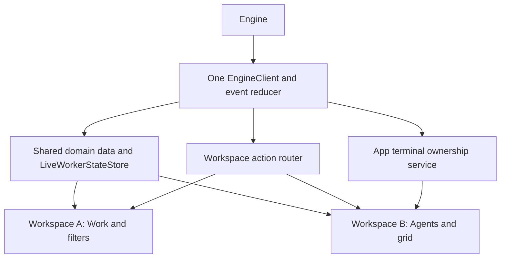

# Native macOS window tabs for Boss

- **Date:** 2026-11-11
- **Scope:** Native tabs for top-level Boss pages, starting with Agents; investigation only.
- **Source baseline:** `fa056b7401a14ab1f09e003b604a255ca58160c3` on `main`. Source links below use repository-relative paths and line anchors at this revision.
- **Related investigations:** [Agents pane capacity](agents-pane-capacity-validation-2026-10-15.md), [isolated second instance](isolated-second-boss-instance-e2e-testing-2026-10-09.md).

Boss can use macOS window tabs to keep Agents beside a board, tear Agents onto another display, and merge it back. The app already has a suitable SwiftUI scene, but shared navigation and single-recipient terminal callbacks make this a state-ownership change as well as a window-management change.

## Verdict

**Use one full Boss window per native tab, with independent page and product selection.** Keep `WindowGroup`, one process-wide engine connection, and one interactive owner for each terminal surface. Let AppKit group and detach those windows; do not turn the existing segmented page picker into a custom draggable tab strip.

This is feasible on Boss's macOS 15 deployment floor. Native tabs themselves are the smaller part; separating presentation state, terminal lifetime, and active-window routing is the larger part. Estimate **5–8 engineer-weeks**, including integration and multi-display validation, across the nine bounded PRs below. This is a planning estimate from dependency inspection, not a measured implementation result.

## Method and evidence limits

The investigation traced the current scene, navigation mutations, engine event consumer, subscription calculation, Ghostty host lifetime, focus callbacks, window chrome, and capture selection. It also checked Apple's primary documentation for native tabs, SwiftUI window identity, command focus, and restoration.

**Static feasibility result:** Boss already uses `WindowGroup`; Apple documents native tab grouping for that scene. No explicit `tabbingMode`, `tabbingIdentifier`, or `newWindowForTab` implementation was found in the app's Swift sources. This supports retaining the scene, but does not prove the current app safely supports two independently navigable tabs.

**No runtime spike was executed.** A useful experiment needs a tab-aware fixture with assertions about terminal identity; the existing capture path has no native-tab scenario. Creating that fixture would require source/build edits beyond this document. No interactive tabbing session was run, and no screenshot is claimed as evidence. The implementation acceptance matrix below identifies the remaining experiments.

## 1. Current architecture

### Scenes, navigation, and chrome

| Area                      | Observed structure and consequence                                                                                                                                                                                                       | Source                                                                                                                                                                                               |
| ------------------------- | ---------------------------------------------------------------------------------------------------------------------------------------------------------------------------------------------------------------------------------------- | ---------------------------------------------------------------------------------------------------------------------------------------------------------------------------------------------------- |
| Main scene                | `BossMacApp` owns one `@StateObject chatModel` and injects it into every `ContentView` created by an unkeyed `WindowGroup`. A second window gets the same model. Restoration is explicitly disabled; default size is 1060 × 680.         | [`BossMacApp.swift:13–46`](../../app-macos/Sources/BossMacApp.swift#L13-L46)                                                                                                                         |
| Other scenes              | Settings; singleton markdown, review terminal, Notifications, Activity and diagnostic windows; value-keyed Design Doc, Transcripts and Screenshots groups. These are separate roles, not top-level workspace tabs.                       | [`BossMacApp.swift:81–204`](../../app-macos/Sources/BossMacApp.swift#L81-L204)                                                                                                                       |
| Page vocabulary           | Agents, Work, Designs, Automations, Ideas. The board is the Work page.                                                                                                                                                                   | [`Models+Automations.swift:12–20`](../../app-macos/Sources/Models+Automations.swift#L12-L20)                                                                                                         |
| Navigation root           | A `ZStack` keeps Work's `NavigationSplitView` and Agents mounted using opacity/hit testing. Other pages are conditional. Existing comments explain terminal teardown and competing split-view toolbar identities.                        | [`ContentView.swift:38–116`](../../app-macos/Sources/ContentView.swift#L38-L116)                                                                                                                     |
| Product/project navigator | Work's sidebar drives the shared product and project filters; selection changes clear card selection and update subscriptions. Project selection can be a set, not one project.                                                          | [`ContentView.swift:709–823`](../../app-macos/Sources/ContentView.swift#L709-L823), [`ChatViewModel+WorkSelection.swift:57–108`](../../app-macos/Sources/ChatViewModel+WorkSelection.swift#L57-L108) |
| Toolbar                   | The native segmented Mode picker writes shared `navigationMode`; search and action availability read the shared model. Title currently reflects product, so two pages of the same product would be indistinguishable in window listings. | [`ContentView.swift:230–339`](../../app-macos/Sources/ContentView.swift#L230-L339)                                                                                                                   |
| Banners                   | SwiftUI content is hosted in an AppKit titlebar accessory so the split view remains the window root. The accessory already detaches/reinstalls when its host window changes. Reuse this interop pattern.                                 | [`TitlebarAccessory.swift:64–122`](../../app-macos/Sources/TitlebarAccessory.swift#L64-L122)                                                                                                         |
| Deployment/build          | The app target requires macOS 15.0. Bazel links GhosttyKit; comments describing Ghostty as SwiftPM-only are stale and must not guide the design.                                                                                         | [`BUILD.bazel:102–108`](../../app-macos/BUILD.bazel#L102-L108), [`BUILD.bazel:428–463`](../../app-macos/BUILD.bazel#L428-L463)                                                                       |

### State that is local versus shared today

`ContentView` owns local `WorkersWorkspaceModel`, `BossPaneModel`, search expansion, update-quit request, and banner confirmation state. `WorkersDetailView` owns an `AgentsGridModel`; each board column has a local scroll anchor. Those are per-view-tree instances, while their shared inputs can still couple the windows. See [`ContentView.swift:20–36`](../../app-macos/Sources/ContentView.swift#L20-L36), [`WorkersDetailView.swift:24–29`](../../app-macos/Sources/Ghostty/WorkersDetailView.swift#L24-L29), and [`WorkBoardColumnScrollView.swift:40`](../../app-macos/Sources/WorkBoardColumnScrollView.swift#L40).

The app-wide `ChatViewModel` mixes domain data with presentation: page, product/project filters, search, selected card, reveal completion/viewport, create/edit requests, panel width/collapse, selected idea and draft, and selected design document. Shared defaults persist much of the selection. This means opening another window does **not** make its selection independent. See [`ChatViewModel.swift:15–22`](../../app-macos/Sources/ChatViewModel.swift#L15-L22), [`275–485`](../../app-macos/Sources/ChatViewModel.swift#L275-L485), [`630`](../../app-macos/Sources/ChatViewModel.swift#L630), and [`871–980`](../../app-macos/Sources/ChatViewModel.swift#L871-L980).

The same model creates the `EngineClient`, process controller, comment bridge and review notifier. It owns the data caches and `LiveWorkerStateStore`. `engine.onEvent` is a single callback installed once, which routes events on the main actor. See [`ChatViewModel.swift:845–923`](../../app-macos/Sources/ChatViewModel.swift#L845-L923) and [`ChatViewModel+EventHandling.swift:11–28`](../../app-macos/Sources/ChatViewModel+EventHandling.swift#L11-L28).

There is an additional ownership collision: every `ContentView.task` overwrites the shared attach/detach/focus/list-pane and coordinator handlers with closures capturing its own terminal models. Each Agents view also overwrites singleton runtime focus/cell-size callbacks. The last view to bind can receive actions for another window. See [`ContentView.swift:178–247`](../../app-macos/Sources/ContentView.swift#L178-L247), [`WorkersDetailView.swift:155–187`](../../app-macos/Sources/Ghostty/WorkersDetailView.swift#L155-L187), and [`GhosttyRuntime.swift:126–150`](../../app-macos/Sources/Ghostty/GhosttyRuntime.swift#L126-L150).

## 2. Target model and platform mapping

### A tab is a navigable Boss workspace

Choose a full Boss workspace per tab. Each has a stable UUID, its own page, product and project filters, and its own toolbar context. “Agents — Mono” and “Work — Mono” can sit in one native tab group; detaching Agents preserves that workspace. Switching the detached workspace to Work remains allowed.

This choice reuses the existing five-page navigation and accommodates two filtered boards. A fixed singleton window for each page would introduce special navigation rules, prohibit duplicate boards, and still require terminal ownership. Retain the Mode picker as navigation _within_ a workspace; native tabs represent separate workspace instances. Provide “Open Agents in New Tab” so the initial multi-display workflow is direct: leave Work open, create an Agents tab, then drag that native tab out.

Use a value-keyed `WindowGroup` with a lightweight `Codable`/`Hashable` workspace UUID and a default-value factory for new windows. Do not key it only by page or product: reopening an existing value focuses that window instead of creating a distinct workspace. Instantiate a window model at the scene's content root; inject shared services separately. Apple documents independent view state and value-based window reuse in [WindowGroup](https://developer.apple.com/documentation/swiftui/windowgroup).

### Native operations and required interop

| Operation                                 | Recommended implementation                                                                                                                                                                                                                                                                                                                                 |
| ----------------------------------------- | ---------------------------------------------------------------------------------------------------------------------------------------------------------------------------------------------------------------------------------------------------------------------------------------------------------------------------------------------------------- |
| Native tab bar                            | Keep standard titled, resizable main windows. Assign workspace windows one compatibility identifier, such as `boss.workspace`. Set the tab title to page plus product; keep a distinct UUID for workspace identity.                                                                                                                                        |
| Ordinary new window                       | Use the workspace scene factory. Start with `.automatic` tabbing policy, honoring the macOS preference for ordinary window opening.                                                                                                                                                                                                                        |
| New Tab / ⌘T / native plus                | Create a fresh UUID seeded from the originating workspace's page and filters, without copying sheets, in-flight actions, or terminal ownership. Register the new `NSWindow`, then explicitly add it to the originating group. This explicit request must work regardless of the ordinary-window preference. “Open Agents in New Tab” seeds Agents instead. |
| Drag tab to another display               | Let AppKit detach the member window. Preserve its workspace UUID and content identity; never implement this as closing a scene and opening a replacement.                                                                                                                                                                                                  |
| Drag back / Merge All Windows             | Use native grouping of compatible workspace windows. Settings, inspectors, viewers and diagnostic windows must be excluded with disallowed tabbing or separate compatibility identifiers.                                                                                                                                                                  |
| Move Tab to New Window                    | Route to the current workspace window's `moveTabToNewWindow(_:)`; let AppKit validate the command when there is no detachable group.                                                                                                                                                                                                                       |
| Next/previous tab, overview, show tab bar | Use standard AppKit actions and validation. Preserve system shortcuts rather than registering duplicate global key monitors.                                                                                                                                                                                                                               |

Apple's [tabbing mode](https://developer.apple.com/documentation/appkit/nswindow/tabbingmode-swift.property) defaults to `.automatic` and should be configured before display. `.preferred` is an alternative when Boss explicitly wants new compatible windows to join tabs, but should not be used globally to force unrelated viewers into a group. [Tabbing identifiers](https://developer.apple.com/documentation/appkit/nswindow/tabbingidentifier-swift.property) determine compatible windows; they are not unique workspace or saved-layout IDs. These AppKit APIs date to macOS 10.12, below Boss's deployment floor.

`openWindow` creates/selects a SwiftUI scene; it does not return an `NSWindow` or take a destination native tab group. A small AppKit bridge must associate workspace UUIDs with weak window references, observe attachment/key/close changes, and fulfill pending “new tab in this group” requests once the exact destination window registers. Use [addTabbedWindow(\_:ordered:)](https://developer.apple.com/documentation/appkit/nswindow/addtabbedwindow%28_:ordered:%29) for explicit placement. Avoid selecting `NSApp.windows.last` or delaying by an arbitrary timer.

The native plus button invokes [newWindowForTab(\_:)](https://developer.apple.com/documentation/appkit/nsresponder/newwindowfortab%28_:%29); its responder-chain implementation must reach the same factory as ⌘T. First use the standard `WindowGroup` behavior and verify it. Add a responder/AppDelegate bridge only where the custom seed/group routing requires it; do not replace SwiftUI's private window delegate or attach a competing controller to a SwiftUI-owned window.

**Fallback if the scene bridge cannot reliably configure windows before presentation:** own the main windows with an `NSWindowController` factory hosting SwiftUI content. That gives explicit creation, grouping and restoration hooks, but also transfers toolbar, lifecycle and restoration responsibilities to Boss. It is a larger fallback, not a prerequisite. Prove the smaller `WindowGroup` approach on macOS 15 and macOS 26 before choosing it; avoid newer SwiftUI APIs that would raise the deployment floor.

## 3. Per-window state and shared event fan-out

Keep `ChatViewModel` as the shared service/data owner during the migration; extract a presentation-only window model rather than constructing a second `ChatViewModel`. Its initializer creates a transport and process controller, so cloning it would duplicate registration, notifications and polling, not just state. Selection-dependent caches and methods must accept a window selection or move to the presentation model; forwarding a window property back into the old global field would retain the bug.

| State                                                                                   | Target owner and lifetime                                                                                                                                                          |
| --------------------------------------------------------------------------------------- | ---------------------------------------------------------------------------------------------------------------------------------------------------------------------------------- |
| Page, selected product, project filter set, selected card/node                          | Window model keyed by workspace UUID. Initialize new windows from a snapshot, then mutate independently.                                                                           |
| Work search, grouping, archived/parked/blocked/chore filters                            | Window model; derived board/attention collections computed for that selection. Shared domain caches remain keyed by product/task.                                                  |
| Agents grid page, type/project filter, layout, focused/highlighted run                  | Window-local `AgentsGridModel`; consume shared membership and only the surfaces owned by that workspace. Keep grid pagination distinct from native window tabs.                    |
| Scroll anchors, keyboard focus, sidebar visibility, panel size/collapse                 | Window/view state. Preserve anchors across native grouping; serialize stable anchors where useful, never responder pointers.                                                       |
| Toolbar selection, search expansion, popovers, sheets, pending create/edit/merge UI     | Originating workspace. Shared mutation outcomes route back by request ID and workspace ID; do not show one confirmation in every window.                                           |
| Ideas drafts, design selection, automation selection/history visibility                 | Window presentation state. Shared saves/content caches retain domain identity; concurrent editing of one idea needs existing save reconciliation plus independent draft ownership. |
| Products, projects, tasks, live worker feed, auth, settings, connection health, updates | App-wide services. Report shared status in each window, but perform effects once. Board style and deliberate app preferences can remain global.                                    |
| Terminal sessions, runtime, pane attachment ledger                                      | App terminal service; one surface owner per pane. A window observes ownership, rather than acquiring a new engine connection.                                                      |

Today `desiredWorkTopics` includes only `currentSelectedProductID`; switching that selection unsubscribes from the previous product. Change this to a token/ref-counted union of all live workspace and auxiliary-view interests, keeping global topics subscribed once. Closing a window removes only its interest. On reconnect, replay the union and deduplicate work-tree requests using the existing request/coalescing paths. Existing execution consumer tokens offer a reuse precedent. See [`ChatViewModel+WorkLookups.swift:227–261`](../../app-macos/Sources/ChatViewModel+WorkLookups.swift#L227-L261) and [`ChatViewModel.swift:105–108`](../../app-macos/Sources/ChatViewModel.swift#L105-L108).

Keep `engine.onEvent` installed once. Reduce domain events once, then publish observable data to interested windows; route engine requests to exactly one workspace/terminal owner and send exactly one response. Move the five-second critical-priority poll out of each `ContentView` into a shared service as part of this split ([`ContentView.swift:129–137`](../../app-macos/Sources/ContentView.swift#L129-L137)). Visibility-driven Automations reads must aggregate consumers instead of one window turning another's reads off. Preserve the existing connection-scoped background-work poll as a single shared loop ([`ChatViewModel+BackgroundWork.swift:17–38`](../../app-macos/Sources/ChatViewModel+BackgroundWork.swift#L17-L38)).

## 4. Terminal panes: ownership and movement

### Constraints in the existing integration

One Ghostty surface cannot be displayed simultaneously in two Boss windows. `makeSurface` passes one host `NSView` as both the platform view and callback userdata; `TerminalPaneSession` has one weak `hostView`. Two representables using the same session would create two surfaces and overwrite that pointer. See [`GhosttyTerminalView.swift:38–60`](../../app-macos/Sources/Ghostty/GhosttyTerminalView.swift#L38-L60), [`329–344`](../../app-macos/Sources/Ghostty/GhosttyTerminalView.swift#L329-L344), and [`TerminalPaneSession.swift:182–246`](../../app-macos/Sources/Ghostty/TerminalPaneSession.swift#L182-L246).

A separate Ghostty surface could attach another tmux client to the same durable worker session. That is **not** surface sharing: it adds a PTY, client, renderer, input path and potentially conflicting terminal dimensions. Do not enable mirrored interactive viewers in the first implementation. The current worker viewer launches `tmux attach-session`; detaching a viewer marks its local session released and removes it, while worker execution belongs to the engine. See [`WorkersWorkspaceModel.swift:109–134`](../../app-macos/Sources/Ghostty/WorkersWorkspaceModel.swift#L109-L134), [`209–224`](../../app-macos/Sources/Ghostty/WorkersWorkspaceModel.swift#L209-L224), and [`335–349`](../../app-macos/Sources/Ghostty/WorkersWorkspaceModel.swift#L335-L349).

`GhosttyTerminalView.dismantleNSView` calls `tearDown`, which clears focus, drains queued focus work and frees the surface asynchronously while retaining the host for callbacks. Reusing only the Swift session model after dismantle does not preserve terminal scrollback. `AgentSurfaceCollection` deliberately keeps attached runs mounted across grid pages; the Work coordinator likewise keeps its expanded geometry while collapsed. Preserve these existing protections. See [`GhosttyTerminalView.swift:509–568`](../../app-macos/Sources/Ghostty/GhosttyTerminalView.swift#L509-L568), [`AgentSurfaceCollection.swift:4–24`](../../app-macos/Sources/Ghostty/AgentSurfaceCollection.swift#L4-L24), and [`ContentView.swift:1006–1029`](../../app-macos/Sources/ContentView.swift#L1006-L1029).

`BossPaneModel` represents the singleton coordinator viewer, reusing its spawn token across reconnects and recreating only the viewer after exits. It must become app-owned; one instance per workspace would create competing viewers of the same coordinator. “Send to Coordinator” must target that owner's surface regardless of which workspace initiated the send. See [`BossPaneModel.swift:6–85`](../../app-macos/Sources/Ghostty/BossPaneModel.swift#L6-L85) and [`ContentView.swift:190–198`](../../app-macos/Sources/ContentView.swift#L190-L198).

### Recommended ownership contract

- Maintain an app-wide ledger keyed by worker run ID or coordinator identity, containing the session, retained host, owner workspace UUID and lifecycle generation. Keep terminal runtime and attach/list/detach handlers at this boundary.
- The first explicitly requesting Agents workspace claims an unowned worker pane. Engine-initiated attachment selects one designated workspace through the router, even when its Agents page is hidden; merely mounting hidden page trees must not acquire duplicate leases. Subsequent windows show live metadata and **“Terminal open in Agents — [workspace]”** with **“Show Window”**; they do not attach another client. Disjoint sets of workers can therefore be owned by different windows.
- For the coordinator, the first Work workspace claims the one viewer. Other Work windows show the same noninteractive ownership notice. Commands that send coordinator input continue through the single app service; focusing the coordinator selects its owning tab.
- Native tear-off/merge changes grouping, not logical ownership. Keep workspace UUID, session and host identity stable. If AppKit changes the host's containing window, rebind window observers/accessories and geometry without calling the release path. Treat actual host movement as a lifecycle transition to validate, not a promise that `NSWindow` identity never changes.
- An optional explicit **“Move Terminal Here”** is a later capability, distinct from native tab tear-off. It requires transferring the retained host between mount containers on the main actor: revoke old focus, remove it from the old parent, attach it once to the new parent, update owner/generation, then restore focus after layout. A plain representable dismantle is destructive today; introduce a mount wrapper whose removal does not free a service-owned surface.
- Closing a workspace releases its viewer leases and frees unused surfaces; it does not stop engine workers or reset the coordinator. Cancel coordinator viewer-reattach tasks and invalidate exit callbacks before freeing its host so close cannot immediately recreate an unowned viewer. Another workspace may then acquire a new viewer. Scrollback preservation is required for tab movement; preserving local viewer scrollback after deliberately closing its workspace is outside the first scope. Closing the last window still follows Boss's existing active-worker quit policy ([`BossMacApp.swift:602–615`](../../app-macos/Sources/BossMacApp.swift#L602-L615)).

### Focus, resize and display work

`becomeFirstResponder` and `resignFirstResponder` send focus through a serial queue; mouse-down makes the host first responder; key events target that host's surface. Preserve focus/free ordering and never send a queued key to an owner generation that has changed. Route focus by run ID **and owner workspace**, replacing the singleton `onWorkerFocus` assignment. Cell-size notifications likewise need surface identity instead of one process-global “last cell size.” See [`GhosttyTerminalView.swift:572–611`](../../app-macos/Sources/Ghostty/GhosttyTerminalView.swift#L572-L611), [`683–704`](../../app-macos/Sources/Ghostty/GhosttyTerminalView.swift#L683-L704), and [`GhosttyRuntime.swift:448–449`](../../app-macos/Sources/Ghostty/GhosttyRuntime.swift#L448-L449).

Scope live-resize notifications to the owning window: today every grid receives all windows' resize events and checks whether _any_ window is resizing ([`WorkersDetailView.swift:69–74`](../../app-macos/Sources/Ghostty/WorkersDetailView.swift#L69-L74), [`145–151`](../../app-macos/Sources/Ghostty/WorkersDetailView.swift#L145-L151)). Define effective visibility using the workspace page, selected native tab and occlusion; opacity alone does not establish keyboard focus or accessibility visibility.

The host updates layer scale on backing changes and synchronizes size/content scale/display ID. **Inspection found a multi-display gap to cover:** display ID is updated only inside the size-or-scale-changed branch. A move between equal-scale screens at unchanged size may leave it stale. Track display changes independently, listen for the owning window's screen change, and verify actual renderer behavior. This is a code-path finding, not an observed rendering failure. See [`GhosttyTerminalView.swift:618–636`](../../app-macos/Sources/Ghostty/GhosttyTerminalView.swift#L618-L636) and [`838–870`](../../app-macos/Sources/Ghostty/GhosttyTerminalView.swift#L838-L870).

## 5. Persistence and multiple displays

Production currently opts out of scene restoration. Enable restoration for normal workspace scenes only, retaining deterministic disabled restoration for isolated captures. Use scene storage for serializable page/selection/filter/scroll anchors, and the value-keyed workspace UUID for identity. Existing global selection defaults should seed only the first migrated workspace; they must not overwrite every restored window. Keep app preferences in `BossDefaults`. Apple describes [scene state restoration](https://developer.apple.com/documentation/swiftui/restoring-your-app-s-state-with-swiftui) and the [restoration behavior modifier](https://developer.apple.com/documentation/swiftui/scene/restorationbehavior%28_:%29).

First test what SwiftUI/AppKit restores automatically: member windows, group order, selected tab, frames, fullscreen/Spaces and display placement. Do not assert that `SceneStorage` or frame autosave alone restores a native tab layout. [Frame autosave](https://developer.apple.com/documentation/appkit/nswindow/setframeautosavename%28_:%29) stores geometry and requires a name not in use by another window; it does not encode Boss page/filter state.

If automatic native grouping is incomplete, supplement it with a versioned layout record: workspace IDs, a separate group UUID, ordered members, selected member, frame in points, last detached frame, and display UUID plus saved visible frame. `tabbingIdentifier` remains the compatibility class; it cannot distinguish two saved groups with identical compatibility. Restore scene windows first, then group the exact registered members once. Do not let both a custom restorer and SwiftUI recreate the same windows.

Prefer the previously used display when available. On disconnect/reconfiguration, clamp a recoverable frame into a current screen's visible frame; preserve a minimum usable content size without placing the titlebar offscreen. Display identity and saved coordinates are hints, not guarantees about a future monitor arrangement. Test same-DPI and mixed-DPI screens, negative desktop coordinates, changed scaling, dock/menubar changes, and returning from fullscreen. Never reconstruct a Ghostty pointer or trust an old tmux session identity from restoration; request current engine membership and attach surviving sessions.

If the AppKit-controller fallback is chosen, use `NSWindowRestoration` and secure state encoding through that owner rather than layering a second restoration owner over `WindowGroup`. Apple's [AppKit restoration sample](https://developer.apple.com/documentation/appkit/restoring-your-app-s-state-with-appkit) describes registration, encoding and window recreation. Honor the user's restore/close-on-quit preference; force-quit recovery is a separate case to test, not a guaranteed normal restore.

## 6. Menus, keyboard commands and external actions

Publish window actions through `focusedSceneValue` and read them from command views with `@FocusedValue`. This exposes the active scene's command target even when focus sits inside a terminal; verify the AppKit-hosted responder path. Keep app-wide actions such as Check for Updates shared. Apple's [focused scene values](https://developer.apple.com/documentation/swiftui/view/focusedscenevalue%28_:_:%29) document this command pattern.

| Entry point                                                      | Proposed routing rule                                                                                                                                                                                                                                           |
| ---------------------------------------------------------------- | --------------------------------------------------------------------------------------------------------------------------------------------------------------------------------------------------------------------------------------------------------------- |
| ⌘T / New Tab / native plus                                       | Originating workspace; create a distinct workspace in its native group. Disable workspace-specific actions when only an auxiliary window is active, or use its recorded owner.                                                                                  |
| ⌘N                                                               | New workspace using ordinary macOS tab/window preference.                                                                                                                                                                                                       |
| ⌘W, next/previous tab, Merge All Windows, Move Tab to New Window | Native responder-chain action on the active workspace, preserving AppKit validation and standard shortcuts. No invented shortcut for merge/move.                                                                                                                |
| Page picker, search, new task/project, filters                   | Focused workspace's selection and presentation; capture its identity before asynchronous work begins.                                                                                                                                                           |
| `bossctl reveal` / notification selection                        | Prefer the most recently active Work workspace already showing the target product; otherwise use the most recently active workspace, creating one if none exists. Select its native tab, unminimize/raise it, then clear/reconcile only its filters and reveal. |
| `bossctl agents focus` / card's agent action                     | Locate the terminal owner, select that workspace's Agents page and native tab, then focus the live host. If unowned, choose/create an Agents workspace and request attachment once.                                                                             |
| `bossctl open`, ⌘O, Finder document open                         | Preserve the existing Design Doc renderer path, outside the workspace tab group. Record the originating/last-active workspace for contextual actions; do not silently redefine `open` as “open a top-level page.”                                               |
| `bossctl selected-product`                                       | Report the selected product of the most recently active workspace. Auxiliary windows retain their originating workspace context; background updates do not change the report. Re-report after app-session registration.                                         |

These routing choices follow the current “show this item” behavior and avoid changing every open workspace. They need no initial engine protocol expansion: requests already enter once through the app. An optional explicit workspace selector can be added later if external callers need it.

Current reveal changes global navigation and filters, then acknowledges only after the viewport confirms visibility; preserve that completion contract **per window**, including supersession and window-close failures. See [`ChatViewModel+WorkSelection.swift:288–330`](../../app-macos/Sources/ChatViewModel+WorkSelection.swift#L288-L330), [`ChatViewModel+Reveal.swift:35–69`](../../app-macos/Sources/ChatViewModel+Reveal.swift#L35-L69), and [`ChatViewModel+EventHandling.swift:751–803`](../../app-macos/Sources/ChatViewModel+EventHandling.swift#L751-L803). Selected-product reporting is currently scalar ([`ChatViewModel+WorkSelection.swift:191–203`](../../app-macos/Sources/ChatViewModel+WorkSelection.swift#L191-L203)); the active-workspace rule makes that scalar meaningful with multiple windows.

## 7. Risks, validation and alternatives

| Risk                                          | Required check or mitigation                                                                                                                                                                                                                                                                                                                                                  |
| --------------------------------------------- | ----------------------------------------------------------------------------------------------------------------------------------------------------------------------------------------------------------------------------------------------------------------------------------------------------------------------------------------------------------------------------- |
| Accidental surface recreation on detach/merge | Record workspace/session/host/surface identities and tmux client counts across repeated moves. No new surface, attach, worker spawn, or lost local scrollback solely because of grouping.                                                                                                                                                                                     |
| Wrong terminal receives typing                | Test commands with terminal, search, sheet and auxiliary-view focus. Hidden tabs cannot retain interactive focus; release/transfer drains outstanding focus work.                                                                                                                                                                                                             |
| Coordinator duplicated or reset               | Two Work windows show one owner and one notice. Send-from-Ideas reaches that owner exactly once; detach, close/reopen and reconnect do not reset the engine coordinator.                                                                                                                                                                                                      |
| Toolbar/sidebar/titlebar regression           | Test Work and Designs sidebar toggles, search modes, banners, native tab bar and fullscreen together. Preserve the root split-view integration and reuse `TitlebarAccessoryHost`.                                                                                                                                                                                             |
| Duplicate dialogs or stale popover anchors    | Keep transient presentation local; dismiss or re-anchor popovers during movement. A user-confirmed mutation still targets its originating product even if another tab becomes key. Shared update/quit presentation selects one host.                                                                                                                                          |
| Accessibility                                 | Native tab names expose page/product; hidden page trees are accessibility-hidden as well as non-hit-testable. Ownership notices and “Show Window” have useful labels; test VoiceOver and full keyboard navigation. Existing surface hiding provides a pattern ([`AgentSurfaceCollection.swift:20–23`](../../app-macos/Sources/Ghostty/AgentSurfaceCollection.swift#L20-L23)). |
| Multiple view consumers amplify work          | Assert one transport/registration, one critical-priority timer, deduplicated subscriptions and notifications. Measure visible and background tabs; avoid rebuilding all grids for unrelated model publications.                                                                                                                                                               |
| Window-wide event monitors                    | Scope resize and keyboard observations to `event.window`/owning window. The comment layer already passes event windows into routing ([`CommentLayer.swift:165–195`](../../app-macos/Sources/Comments/CommentLayer.swift#L165-L195)).                                                                                                                                          |
| Capture chooses the wrong window              | Current selection prefers an “agent capture” title, then the largest window. Multiple workspaces invalidate that heuristic. Add explicit workspace/window selection for fixtures; keep the default single-window capture deterministic. See [`BossCapture.swift:205–252`](../../app-macos/Sources/BossCapture.swift#L205-L252).                                               |
| Restore contaminates production or capture    | Keep capture restoration disabled, retain isolated defaults, and never save capture window layout into production state. See [`BossDefaults.swift:3–31`](../../app-macos/Sources/BossDefaults.swift#L3-L31) and [`BossMacApp.swift:440–475`](../../app-macos/Sources/BossMacApp.swift#L440-L475).                                                                             |

### Implementation acceptance matrix

Automated model tests should cover two independent page/filter/draft states, subscription-union removal/reconnect, exactly-once action routing, ownership contention/close, and missing-display fallback. Run them through the existing Bazel app test targets and PaneLayout tests, with no cache overrides. The app's current test shards are declared in [`BUILD.bazel:270–366`](../../app-macos/BUILD.bazel#L270-L366).

A native integration fixture must cover: create Work + Agents tabs; ⌘T and native plus; reorder; move tab to a new window; merge; close one tab; close last workspace; reopen; and normal quit/relaunch with two groups. Repeat a detach/merge cycle at least ten times with a live test terminal and compare identity, input, scrollback and attachment counts. Exercise equal-scale and mixed-scale display moves, resize, sleep/wake, fullscreen, and unplug/reconnect. Run on macOS 15 and macOS 26; neither a pure model test nor a static screenshot proves physical drag behavior.

Use only fixture engines and quiet app captures. Start the engine with `env -u BOSS_EVENTS_SOCKET bazel run //tools/boss/engine/core:engine -- --socket-path <private-temp-directory>/engine.sock`; point a client/app to that same socket. Capture with `BOSS_SOCKET_PATH=<fixture-socket> BOSS_ENGINE_AUTOSTART=0 bazel run //tools/boss/app-macos:Boss -- --capture-to <temp-png>`. Recheck the [isolation investigation](isolated-second-boss-instance-e2e-testing-2026-10-09.md) before enabling live fixture terminals; a socket override alone is not evidence that every ancillary path is isolated. Never launch the installed app. Register and inspect captures, recording that `cacheDisplay` proves layout only, not native drag handling or live Metal rendering. The capture implementation explicitly permits rendering without ordering the window front ([`BossCapture.swift:133–174`](../../app-macos/Sources/BossCapture.swift#L133-L174)).

### Alternatives and effort difference

| Approach                                  | Benefit                                                                                     | Cost and limitation                                                                                                                                                                                                                                                                                                                            |
| ----------------------------------------- | ------------------------------------------------------------------------------------------- | ---------------------------------------------------------------------------------------------------------------------------------------------------------------------------------------------------------------------------------------------------------------------------------------------------------------------------------------------- |
| Recommended native workspace tabs         | Requested Xcode-style grouping, drag-out/drag-back, native menus, multiple boards/products. | Approximately 5–8 engineer-weeks; state/terminal migration dominates.                                                                                                                                                                                                                                                                          |
| Dedicated singleton Agents window         | One extra display surface with simple open/focus behavior.                                  | Approximately 3–7 engineer-days and 2–3 small PRs if the Agents tree is moved out of the main window and shared handler ownership is corrected. It does not provide interchangeable native top-level tabs or merge semantics, so it does not meet the requested model. Keeping both Agents trees live would still incur duplicate-viewer work. |
| Custom SwiftUI tabs and drag/drop         | Full visual control.                                                                        | Requires custom detachment, accessibility, persistence and command behavior while retaining all terminal problems. No reason to prefer it here.                                                                                                                                                                                                |
| AppKit-owned main windows hosting SwiftUI | Deterministic window creation, tab grouping and restoration hooks.                          | Fallback if the scene spike fails; allow roughly 1–2 additional engineer-weeks for lifecycle and toolbar integration.                                                                                                                                                                                                                          |

## 8. Reviewable implementation sequence

Estimates include tests and count changed lines, not only additions. Each PR should stay below roughly 1,500 changed lines and 25 files; split at the stated capability boundary if a migration exceeds that envelope. Do not enable multiple workspaces while presentation or terminal ownership remains shared accidentally.

| PR                                                     | Dependency and coherent capability          | Deliverables and likely file areas                                                                                                                                                                                                                                             | Estimated envelope             |
| ------------------------------------------------------ | ------------------------------------------- | ------------------------------------------------------------------------------------------------------------------------------------------------------------------------------------------------------------------------------------------------------------------------------ | ------------------------------ |
| 1. Workspace identity and shared interests             | Foundation; behavior remains single-window. | Workspace UUID/registry and presentation-model shell; retain one `ChatViewModel`; tokenized product-interest union, request deduplication and shared polling. `BossMacApp`, `ChatViewModel+WorkLookups`, connection/refetch helpers and focused tests.                         | 900–1,300 lines, 12–20 files   |
| 2. Independent navigation and board selection          | After 1.                                    | Move page/product/project/search/filter/panel state and selection-dependent board caches behind window selection; migrate navigator and Work toolbar. Keep shared mutation services explicit about target IDs. Tests with two model instances, while UI remains single-window. | 1,100–1,450 lines, 18–24 files |
| 3. Independent secondary-page presentation             | After 2.                                    | Migrate Ideas drafts, Designs/Automations selection, consumer visibility and page-local toolbar state. Shared caches stay shared; cover drafts and asynchronous product switching.                                                                                             | 900–1,400 lines, 15–23 files   |
| 4. Window-scoped actions and transient UI              | After 2–3.                                  | Focused command context, reveal/notification/selected-product router, origin IDs for sheets/popovers and asynchronous errors. Reuse document open paths; exactly-once replies and window-close cancellation tests.                                                             | 1,000–1,450 lines, 16–24 files |
| 5. Shared terminal ownership                           | After 1; integrate after 4.                 | Lift worker/coordinator sessions and engine pane callbacks into an app service; retain surfaces independently of mounting; owner/generation ledger and lifecycle tests. Keep existing single-window visuals.                                                                   | 1,000–1,450 lines, 12–20 files |
| 6. Multiple terminal consumers and display correctness | After 5.                                    | Ownership notices and Show Window; window-scoped grid focus/resize/cell metrics; display-ID update independent of size; close/reacquire behavior. Cover coordinator and worker duplicates. Explicit cross-workspace surface transfer can remain deferred.                      | 1,000–1,450 lines, 14–22 files |
| 7. Native tab creation and movement                    | After 1–6.                                  | Value-keyed main scene, window-registration bridge, compatibility IDs, titles, ⌘T/plus, merge/move actions, auxiliary-window exclusion. Add a quiet native fixture to prove scene/host identity through movement before exposing live terminals.                               | 850–1,300 lines, 12–20 files   |
| 8. Layout restoration                                  | After 7.                                    | Scene state migration, native restoration verification, supplemental layout record only where needed, missing-display fallback and capture isolation. Test two groups, selected tabs and disconnected monitors.                                                                | 800–1,300 lines, 10–18 files   |
| 9. Acceptance and rollout                              | After 8.                                    | Explicit capture target selection, deterministic capture cases, terminal detach/merge measurements, supported-OS/display/keyboard/accessibility evidence; enable by default only after the matrix passes.                                                                      | 600–1,100 lines, 10–18 files   |

**Flagged first shipment:** PRs 1–6 can ship their single-window refactoring without a new user workflow. PR 7 may ship native workspace tabs behind a default-off, app-local `BossDefaults` preference, following the existing standard-search preference pattern. The repo owner or a tester can enable it in a developer setting on a fixture instance. It ships inert until enabled and requires relaunch; do not hot-switch the scene/window architecture. With the flag off, do not restore multi-workspace layouts into the legacy scene. Reuse the existing defaults accessor rather than inventing a parallel configuration system. Persistent multi-display layouts remain unavailable until PR 8.

## Open questions and follow-up implementation work

No product decision blocks this scope: use full navigable workspaces, one interactive surface owner, context-aware external routing, and ordinary macOS tab preferences. These are recommendations chosen to preserve Boss's current navigation and durable engine-session design.

The implementation spike must resolve three technical uncertainties: whether SwiftUI's native new-tab creation can be reliably seeded and grouped through the bridge; whether Ghostty host identity survives all native detach/merge paths; and how completely native restoration preserves groups across the supported OS versions. Record observed results before enabling the feature. If the bridge fails, use the explicit AppKit-controller fallback described above.

The nine PRs above are follow-up code work, not part of this document. Simultaneous interactive mirroring, explicit “Move Terminal Here,” external workspace-selection arguments, and guaranteed terminal scrollback restoration across process relaunch are separate later capabilities.
